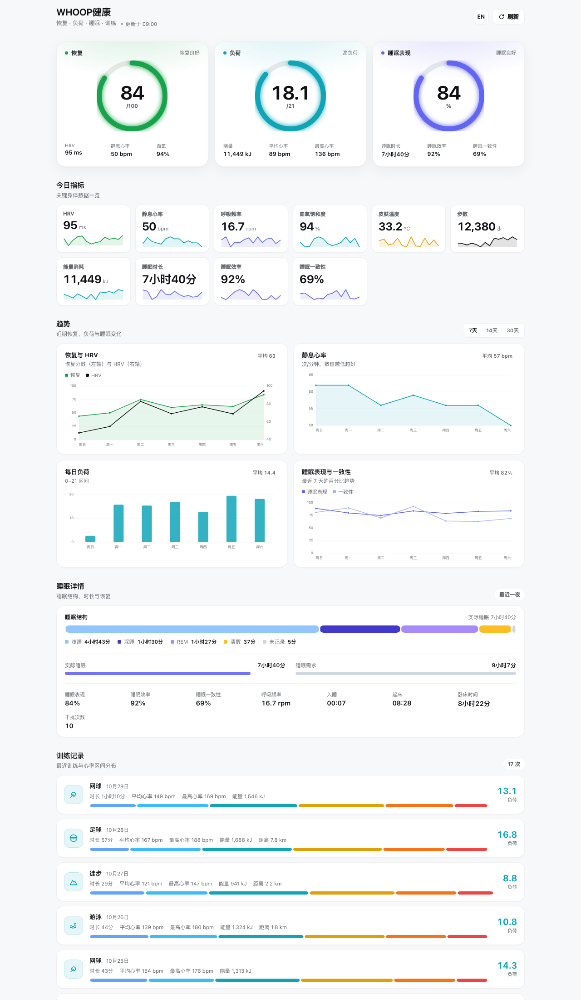
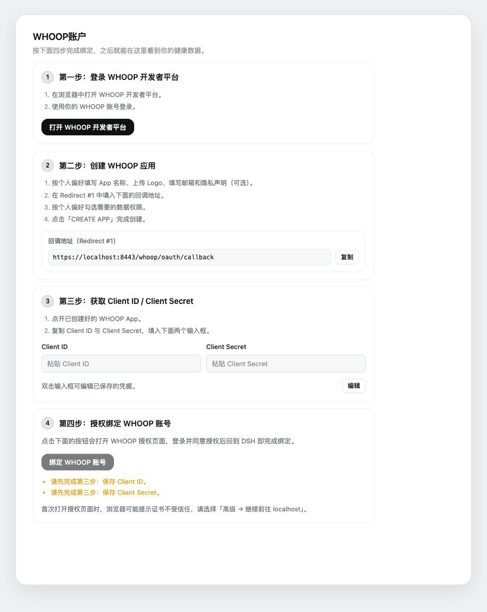

# WHOOP Easy Connect

**dsh-whoop-easy-connect** · 在 [DeepSeek Harness](https://github.com/deepseek-ai/deepseek-harness)（dsh）里轻松连接你的 WHOOP 账号，数据自动同步，并拥有一个专属的健康看板。

[](https://github.com/ShawnRen57/dsh-whoop-easy-connect/releases)
[](https://github.com/deepseek-ai/deepseek-harness)
[](https://developer.whoop.com/)
[](https://nodejs.org/)
[](LICENSE)
[](https://github.com/topics/dsh-plugin)
[](https://github.com/ShawnRen57/dsh-whoop-easy-connect/stargazers)

[简体中文](#简体中文) · [English](#english)



---

## 简体中文

### 三个关键词

- **简单连接**：不用自己拼 OAuth、不用手写配置。设置页里四步引导：打开 WHOOP 开发者平台 → 创建应用 → 粘贴 Client ID / Secret → 点一下授权。回调地址一键复制，插件自动处理本机 HTTPS 回调。
- **自动同步**：连接一次，之后每次打开看板都会自动拉取最新数据；WHOOP 的访问令牌到期前会自动续期（`offline` scope），不需要反复登录。
- **专属看板**：在 DSH 主面板里用三环、趋势图、睡眠结构和训练记录，把 WHOOP 的恢复、负荷、睡眠与运动数据集中在一个页面里看。

### 看板里有什么

| 区域 | 内容 |
| --- | --- |
| 三环主视觉 | 恢复分数（0–100，绿/黄/红语义）、每日负荷（0–21）、睡眠表现（0–100） |
| 今日指标 | HRV、静息心率、呼吸频率、血氧、皮肤温度、步数、能量消耗、睡眠时长 / 效率 / 一致性 |
| 趋势 | 恢复 + HRV、静息心率、每日负荷、睡眠表现与一致性，支持 7 / 14 / 30 天切换 |
| 睡眠详情 | 浅睡 / 深睡 / REM / 清醒结构、实际睡眠 vs 所需睡眠、入睡/起床时间、干扰次数 |
| 训练记录 | 运动类型、时长、负荷、平均/最高心率、能量、距离、心率区间分布 |
| 身体与资料 | WHOOP 账号姓名 / 邮箱、身高、体重、最大心率 |

看板右上角可以 **切换中英文**、**手动刷新**；页面每次进入都会自动刷新一次。界面适配 DSH 的明暗主题。

### 安装

**方式一：直接安装 GitHub 仓库（推荐）**

在终端运行（把 `desktop` 换成你的 DSH profile 名称）：

```bash
dsh plugin --profile desktop add github:ShawnRen57/dsh-whoop-easy-connect
```

也可以让 DSH 里的 Agent 帮你安装：

```text
plugin_manager install_bundle target=github:ShawnRen57/dsh-whoop-easy-connect
```

安装后在 DSH 左侧栏出现 **WHOOP健康** 入口；如果页面没有立即刷新，刷新一次页面。

**方式二：插件市场**

在 DSH 的 **插件 → 发现** 中添加社区插件索引，搜索 “WHOOP Easy Connect” 后安装。开放插件市场索引地址：`https://dshopen.org/index.json`。

### 连接 WHOOP（四步）



1. **登录 WHOOP 开发者平台**：点按钮打开 [developer-dashboard.whoop.com](https://developer-dashboard.whoop.com/)，用你的 WHOOP 账号登录。
2. **创建 WHOOP 应用**：按喜好填写 App 名称、Logo、邮箱和隐私声明（可选）；把页面里的**回调地址**一键复制，填到 `Redirect #1`；勾选数据权限后点 `CREATE APP`。
3. **填写 Client ID / Client Secret**：双击输入框进入编辑，粘贴应用详情里的 Client ID 和 Client Secret，点保存。凭据只保存在本机。
4. **授权绑定**：点「绑定 WHOOP 账号」，在浏览器里登录并同意授权。第一次访问本机回调地址时，浏览器会提示自签名证书，选择「高级 → 继续前往 localhost」即可。

授权完成、浏览器显示「WHOOP 账号已连接」后回到 DSH，看板就会显示你的真实数据。

> 为什么需要自己创建 WHOOP 应用？WHOOP 要求每个应用使用自己的 OAuth 凭据。你只需要在它的开发者后台创建一次应用；回调、令牌交换和续期都由插件自动完成。

### 数据同步与隐私

- **同步方式**：打开看板时自动拉取最近 30 天数据；右上角可随时手动刷新。令牌过期前自动用 refresh token 续期。
- **本地保存**：OAuth 凭据与令牌保存在 `~/.dsh-whoop-easy-connect/state.json`（文件权限 `0600`），自签名证书保存在同目录的 `tls/` 下。
- **数据去向**：插件只直接请求 WHOOP 官方 API（`api.prod.whoop.com`），不向其他第三方发送你的健康数据，也没有遥测。
- **解除绑定**：设置页可以随时「解除绑定」，插件会调用 WHOOP 的吊销接口并删除本地令牌。

### 常见问题

- **浏览器提示证书不受信任**：这是插件为「本机 HTTPS 回调」生成的自签名证书，只影响 `https://localhost:8443`，选「高级 → 继续前往 localhost」即可。
- **授权后仍显示未绑定**：确认第 2 步复制到 WHOOP 应用的 `Redirect #1` 与页面显示的地址完全一致；再确认第 3 步的 Client ID / Secret 已保存成功。
- **部分指标显示「—」**：WHOOP 没有提供该数据（例如设备不支持血氧/皮肤温度，或当天尚未评分），不是插件故障。
- **8443 端口被占用**：插件会记录警告并回退。释放端口后刷新页面，或在插件配置里更换端口并重新登记回调地址。
- **修改代码后如何生效**：浏览器端改动会热更新或刷新页面生效；Host 端代码修改后如果未生效，重启一次 DSH。

### 开发

```bash
node scripts/build-client.mjs      # 生成浏览器端 lib/client.js
node --test scripts/test-host.mjs  # Host 端单元测试（不联网）
```

插件由两半组成：Host 端负责 OAuth、令牌存储和 WHOOP API 聚合；浏览器端负责侧边栏入口、设置引导和健康看板。看板使用纯 SVG 绘制图表，不依赖第三方图表库。

### 许可证与声明

[MIT](LICENSE) © 2026 ShawnRen57

WHOOP、WHOOP 标志及相关名称是 WHOOP, Inc. 的商标。本项目是个人开发的第三方插件，与 WHOOP 官方无关，也未获得 WHOOP 官方背书。

---

## English

**dsh-whoop-easy-connect** — connect your WHOOP account to [DeepSeek Harness](https://github.com/deepseek-ai/deepseek-harness) (dsh) in minutes, keep your data in sync, and explore it in a dedicated health dashboard.

### Why you'll like it

- **Easy connect** — no OAuth plumbing, no hand-written config. A four-step wizard in Settings walks you through creating a WHOOP app, pasting the Client ID / Secret, and authorizing. The callback URL is one click to copy, and the local HTTPS callback is handled for you.
- **Automatic sync** — connect once, then every dashboard visit pulls the latest data automatically. Access tokens refresh themselves before they expire (`offline` scope), so you don't have to sign in again.
- **A dashboard of your own** — recovery, strain, sleep and workout data in one place: rings, trends, sleep stages and workout logs, inside the DSH main panel.

### What's on the dashboard

| Section | Contents |
| --- | --- |
| Hero rings | Recovery score (0–100, green/yellow/red), daily strain (0–21), sleep performance (0–100) |
| Today | HRV, resting HR, respiratory rate, SpO₂, skin temperature, steps, energy, sleep duration / efficiency / consistency |
| Trends | Recovery + HRV, resting HR, daily strain, sleep performance & consistency — 7 / 14 / 30 days |
| Sleep | Light / deep / REM / awake stages, actual vs. needed sleep, bedtime & wake time, disturbances |
| Workouts | Sport, duration, strain, average/max HR, energy, distance, heart-rate zones |
| Body & profile | WHOOP name / email, height, weight, max heart rate |

Switch between **Chinese and English** or refresh manually from the top-right corner. The page refreshes once every time you open it, and follows DSH's light and dark themes.

### Install

**From GitHub (recommended)**

```bash
dsh plugin --profile desktop add github:ShawnRen57/dsh-whoop-easy-connect
```

Or ask the agent inside DSH:

```text
plugin_manager install_bundle target=github:ShawnRen57/dsh-whoop-easy-connect
```

After installing, the **WHOOP健康** entry appears in the DSH sidebar. Refresh the page once if it does not show up immediately.

**From the plugin market**

Add a community plugin index under **Plugins → Discover** in DSH and search for “WHOOP Easy Connect”. The Open Plugin Market index is `https://dshopen.org/index.json`.

### Connect WHOOP in four steps

1. **Sign in to the WHOOP Developer Dashboard** — open [developer-dashboard.whoop.com](https://developer-dashboard.whoop.com/) and sign in.
2. **Create a WHOOP app** — fill in the name, logo, email and privacy statement as you like; copy the **callback URL** shown by the plugin into `Redirect #1`; pick the data permissions and click `CREATE APP`.
3. **Enter Client ID / Client Secret** — double-click the inputs, paste both values from the app details, and save. Credentials stay on your machine.
4. **Authorize** — click “Bind WHOOP account”, sign in on the WHOOP page and approve access. On the first local callback the browser warns about the self-signed certificate; choose “Advanced → Proceed to localhost”.

Once the browser shows “WHOOP account connected”, go back to DSH and the dashboard will show your real data.

> Why create your own WHOOP app? WHOOP requires each app to use its own OAuth credentials. You only create it once in the developer dashboard; the plugin takes care of the callback, token exchange and refresh.

### Sync and privacy

- **Sync** — opening the dashboard fetches the last 30 days of data automatically; you can also refresh manually. Access tokens are refreshed with the refresh token before they expire.
- **Local state** — OAuth credentials and tokens live in `~/.dsh-whoop-easy-connect/state.json` (mode `0600`); the self-signed certificate lives under `tls/` in the same directory.
- **Where data goes** — the plugin talks only to the official WHOOP API (`api.prod.whoop.com`). It does not send your health data anywhere else and contains no telemetry.
- **Unbind** — you can unbind at any time in Settings; the plugin revokes the WHOOP authorization and deletes local tokens.

### FAQ

- **The browser warns about the certificate** — it's the self-signed certificate generated for the local HTTPS callback. It only affects `https://localhost:8443`; choose “Advanced → Proceed to localhost”.
- **Still unbound after authorizing** — make sure the `Redirect #1` value registered in your WHOOP app exactly matches the callback URL shown by the plugin, and that the Client ID / Secret were saved successfully.
- **Some metrics show “—”** — WHOOP did not provide that value (for example a device without SpO₂ / skin temperature, or a day that hasn't been scored yet).
- **Port 8443 is busy** — the plugin logs a warning and falls back. Free the port and refresh, or change the port in the plugin config and register the new callback URL.
- **Code changes don't show up** — browser-side changes hot-reload or apply after a refresh; restart DSH if Host-side changes do not take effect.

### Development

```bash
node scripts/build-client.mjs      # build the browser bundle lib/client.js
node --test scripts/test-host.mjs  # Host-side unit tests (offline)
```

The plugin has two halves: the Host half owns OAuth, token storage and WHOOP API aggregation; the browser half owns the sidebar entry, the setup wizard and the dashboard. Charts are hand-drawn SVG — no chart library.

### License & notice

[MIT](LICENSE) © 2026 ShawnRen57

WHOOP, the WHOOP logo and related names are trademarks of WHOOP, Inc. This is an independent third-party plugin, not affiliated with or endorsed by WHOOP.

---

**Built with [DeepSeek Harness](https://github.com/deepseek-ai/deepseek-harness)**

[](https://github.com/deepseek-ai/deepseek-harness)
